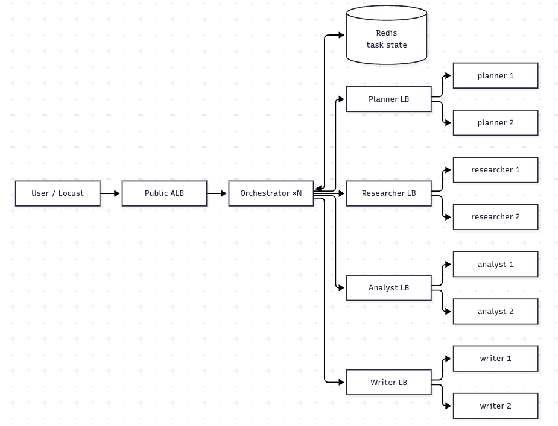
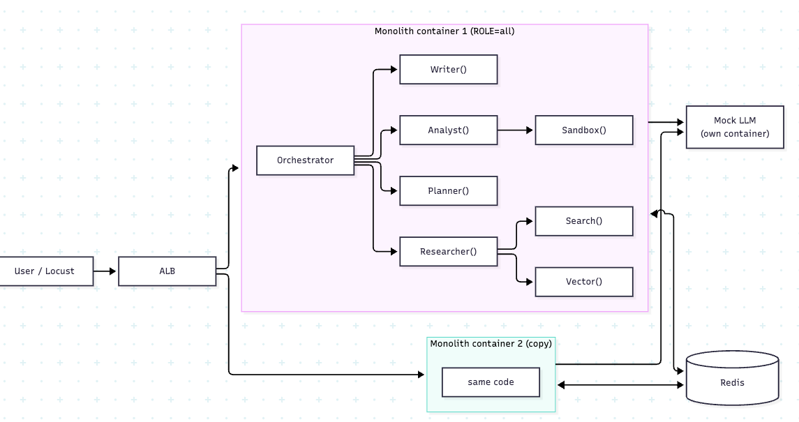

## orchestrator mode: plan-and-execute
Every call is request–response: orchestrator → agent → back to orchestrator. The order is:

```
Quick answer:  Planner ─────────────────────────────→ Writer
Research:      Planner → Researcher (search, vector) → Writer
Analysis:      Planner → Researcher ∥ Analyst (sandbox) → Writer
```

1. one pass, no loop
2. each task is independent, with no conversation history.

Agents don't know about each other and don't need any state; they take input and return output. That's why we can run 2, 3 or 10 copies of any of them.\
Other possible options for the workflow are list below.

### The orchestrator:
1. It isn't an LLM; it's ordinary code that runs a fixed workflow. The LLM-driven decision-making lives in the Planner agent.
2. It calls the agents in the right order.
3. It saves the state of each step in Redis.
4. It applies timeouts, retries and circuit breakers.


### shared state: 

1. Agents keep nothing between calls. All input arrives in the request.
2. The orchestrator owns the task, and saves it in Redis after every step. any orchestrator copy can pick up a task if another one crashes. 

```
task:123  → { status: "running", plan: {...},
              research: {...}, analysis: null, answer: null }
```

### Tools
**Web search**: a local text corpus plus simulated network wait, I/O-bound

**Vector store**: load a few thousand pre-computed embeddings into memory, using FAISS or plain numpy, and return the top-k most similar for each query.

**Code sandbox**: run a fixed, CPU-heavy piece of Python in a subprocess with a timeout, for example multiplying matrices or counting primes. A fixed workload makes the CPU cost repeatable and avoids the security work a real sandbox would need.


### Options(to make it more realistic):
1. Add Loop: writer can ask for more information from researcher and analyst for at most 1 extra round with a fixed probability(say 20%)
2. multi-turn conversaion: Store session's previous session_id


## monolith architecture
